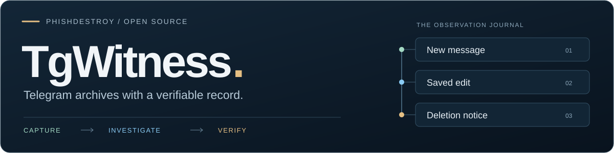
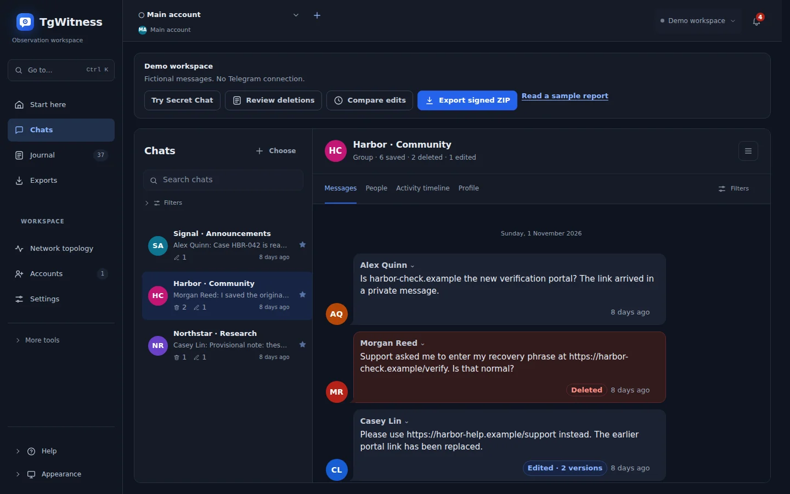
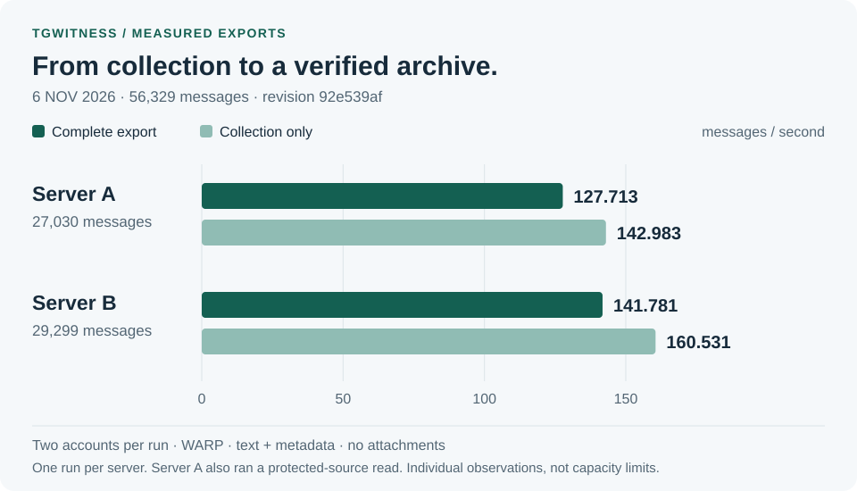
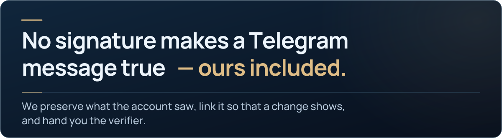

<picture>
  <source media="(max-width: 640px)" srcset="docs/assets/presentation/readme-intro-mobile.svg">
  
</picture>

<p align="center">
  <a href="https://phishdestroy.github.io/TgWitness/demo/?lang=en"><strong>Try the demo</strong></a> &nbsp; · &nbsp;
  <a href="#install"><strong>Install</strong></a> &nbsp; · &nbsp;
  <a href="docs/README.md"><strong>Documentation</strong></a> &nbsp; · &nbsp;
  <a href="docs/VERIFICATION.md"><strong>Verification</strong></a>
</p>

Save account-visible Telegram chats, retain captured edits and deletion notices,
investigate connections, and share signed exports that a recipient can check.
Run it on your own computer or server.

<p align="center">
  <a href="docs/CHANGELOG.md"></a>
  <a href="LICENSE"></a>
  <br><sub>25 interface languages · 26 guide languages · <a href="docs/STATUS.md">Current capabilities</a></sub>
</p>

<a name="screenshots"></a>

<a href="https://phishdestroy.github.io/TgWitness/demo/?lang=en">
<picture>
  <source media="(max-width: 640px) and (prefers-reduced-motion: reduce)" srcset="docs/assets/presentation/readme-workspace-mobile-dark-still.webp">
  <source media="(prefers-reduced-motion: reduce)" srcset="docs/assets/presentation/readme-workspace-dark-still.webp">
  <source media="(max-width: 640px)" srcset="docs/assets/presentation/readme-workspace-mobile-dark.webp">
  
</picture>
</a>

<p align="center"><sub>Explore the interface with fictional records. No Telegram login required for the demo.</sub></p>

<a name="quick-start"></a>
<a name="run-it-on-your-machine"></a>

## Install

Python is included. Run the same command again to update.

**Linux / macOS**

```sh
curl -fsSL https://get.destroy.tools/install.sh | bash
```

**Windows · PowerShell or CMD**

```powershell
powershell.exe -NoProfile -ExecutionPolicy Bypass -Command "irm https://get.destroy.tools/install.ps1 | iex"
```

Ubuntu server: run as root. Desktop: run as your normal user.

[Setup and panel access](docs/INSTALLATION.md) ·
[Verify the download](https://get.destroy.tools/#verification) ·
[ZIP packages](https://github.com/phishdestroy/TgWitness/releases) ·
[Docker and servers](docs/DEPLOYMENT.md)

<details>
<summary>Builds and updates</summary>

The version badge describes this source tree. The download site receives checked
builds from `main` after Linux and Windows installation tests pass. Failed builds
leave the previous download available; installed panels update when you rerun the
installer. Tagged packages are listed under
[Releases](https://github.com/phishdestroy/TgWitness/releases).

</details>

<a name="from-a-conversation-to-a-case"></a>
<a name="built-for-the-rest-of-the-investigation"></a>

## Work with the archive

| Workflow | What you get |
| --- | --- |
| **[Export a chat or account](docs/ACCOUNT-EXPORT.md)** | Available history, selected attachments and readable HTML/JSON views, with resumable acquisition and verification. |
| **[Follow changes](docs/COLLECTION.md)** | New messages, captured edits and deletion notices saved in a signed observation journal. |
| **[Build an investigation](docs/INVESTIGATION.md)** | Search across recorded chats, compare versions, connect people and links, and prepare a case report. |

Each account has its own workspace, session and signing key. Select individual
chats, a Telegram folder or the whole account. Choose the period and attachment
policy before collecting.

[Collection methods](docs/COLLECTION-MODES.md) · [Export settings](docs/EXPORT_HASHES.md) ·
[Case Board](docs/CASE-BOARD.md) · [Report Studio](docs/CASE_REPORTS.md)

<details>
<summary>Accounts, search and integrations</summary>

| Area | Guides |
| --- | --- |
| Accounts | [Sign in or import a session](docs/ACCOUNTS.md) · [Account groups](docs/ACCOUNTS.md#bulk-import-and-account-groups) |
| Connection | [SOCKS5, HTTP and MTProxy](docs/CONNECTION-SECURITY.md) · [Proxy pool](docs/wiki/Proxies.md#pool-dashboard-and-custom-sources) |
| History | [Load older messages](docs/HISTORY.md) · [Distributed export](docs/DISTRIBUTED-EXPORT.md) · [Pacing and limits](docs/EXPORT-LIMITS.md) |
| Analysis | [Full-text search](docs/SEARCH.md) · [AI with source references](docs/ANALYSIS.md) · [Local OCR and transcription](docs/MEDIA-ANALYSIS.md) |
| Integrations | [CLI](docs/CLI.md) · [Read-only MCP](docs/MCP.md) · [Signed webhooks](docs/WEBHOOKS.md) |
| Team access | [Scoped access, expiry and permissions](docs/ACCESS.md) |
| Independent capture | [Browser and AyuGram](docs/OPTIONAL-CAPTURE.md) · [Trusted Live](docs/TRUSTED-LIVE.md) · [Official client witness](docs/OFFICIAL-WITNESS.md) |

Preview features and their remaining qualification are recorded in
[Current capabilities](docs/STATUS.md).

</details>

<a name="capture-with-github-provenance"></a>

<details>
<summary>Capture on a temporary GitHub runner</summary>

**Preview.** Collect a chat with a pinned TgWitness and a fresh Telegram session,
then download the encrypted archive with its GitHub attestation. Verification
checks the approved workflow and collector version, the archive digest, journal
and attachments. Large encrypted deliveries can be split into parts; a deadline
produces a recorded partial result.

[Open the capture page](https://phishdestroy.github.io/TgWitness/docs/capture/) ·
[Instructions](docs/SEALED-ACTIONS.md)

</details>

<a name="how-it-works"></a>
<a name="a-record-someone-else-can-check"></a>

## Verify what you share

The export includes the records, file manifest and verifier. Give the recipient
your trusted key fingerprint and a retained checkpoint through a separate channel:

```sh
python -m tgwitness.verify evidence.zip --fingerprint TRUSTED_SHA256 --checkpoint checkpoint.json
```

| Layer | What it checks |
| --- | --- |
| Signed journal and file manifest | Record signatures, the hash chain and delivered files against the expected key. |
| Retained checkpoint or independent witness | The archive against an earlier journal state held separately. |
| GitHub provenance or Intel TDX | The approved capture workflow or measured execution environment, within its stated scope. |

Signatures establish integrity against trusted inputs. They do not establish
Telegram authorship or complete message delivery.

[Verification guide](docs/wiki/Exports-and-Verification.md) · [Evidence format](docs/EVIDENCE.md) ·
[Independent witness](docs/WITNESS.md) · [External timestamps](docs/TIMESTAMP.md)

<a name="choose-what-backs-the-record"></a>

<details>
<summary>Collection scope and deployment choices</summary>

For live observation, history or a one-off export, choose a
[collection method](docs/COLLECTION-MODES.md). Private cloud chats are available
when the connected account can access them. The ordinary collector does not collect
Telegram Secret Chats. A separate implementation exists in development; see
[Secret Chat availability and the demo](docs/PSEUDO-SECRET.md) and
[collection scope](docs/COLLECTION.md).

Run locally, use an audited VM, or collect inside a Phala Cloud confidential VM
with Intel TDX. These checks cover different parts of the collection environment.
The TDX verifier checks Intel's quote and revocation data, a signed collector
statement and fresh challenge, and the expected OS and application measurements.

[Phala / Intel TDX](docs/HIGH-ASSURANCE.md) ·
[Recorded live deployment](docs/VERIFICATION.md#live-phala-cloud-deployment--4-november-2026) ·
[Trust boundaries](docs/SECURITY-MODEL.md)

</details>

<a name="measured-exports--6-november-2026"></a>

## Measured exports

**56,329 records across two fresh exports.** Both signed archives verified against
pinned collector keys. Recorded on 6 November 2026 at
[`92e539af`](https://github.com/phishdestroy/TgWitness/commit/92e539af40d8368d198ff5e040f1d876f2c1310e).

<a href="https://phishdestroy.github.io/TgWitness/docs/validation/">
<picture>
  <source media="(max-width: 640px)" srcset="docs/assets/presentation/readme-performance-mobile.svg">
  
</picture>
</a>

Text and metadata through WARP, two accounts per server, no attachments or reused
records. Complete-cycle rates include packaging and verification. These are
individual workloads, not a capacity guarantee.

[Measurements and method](https://phishdestroy.github.io/TgWitness/docs/validation/) ·
[Signed English audit](website/validation/audit/README.md) ·
[Fictional sample export](https://phishdestroy.github.io/TgWitness/demo/downloads/tgwitness-demo.zip)

<details>
<summary>Capture and evidence review</summary>

<!-- authors-manifesto:start -->

<a name="manifesto"></a>

## Check the capture and the saved record

<picture>
  <source media="(max-width: 640px)" srcset="docs/assets/presentation/readme-manifesto-mobile.svg">
  
</picture>

TgWitness records content delivered to the connected Telegram account, with
chat, message and sender identifiers, captured versions and collection metadata.
The archive brings those records, preserved attachments and verification data
together for review.

| Check | What the recipient verifies |
| --- | --- |
| Signed journal and manifest | Record signatures, the hash chain and delivered files against the expected signing key. |
| Separately retained checkpoint | The journal against a previously recorded length and head hash. |
| Independent witness | The journal against checkpoints retained by a separate witness. |
| GitHub Actions capture | The archive against its attestation, approved hosted workflow and collector version. |

[Export Clinic](https://phishdestroy.github.io/TgWitness/docs/export-clinic/)
shows a Telegram conversation beside deliberately altered Desktop export files.
Compare the versions, inspect the changes, and follow the collection and
verification steps for a signed TgWitness archive.

[Verification steps](docs/wiki/Exports-and-Verification.md) ·
[GitHub capture](docs/SEALED-ACTIONS.md) ·
[Technical trust model](docs/SECURITY-MODEL.md)

<!-- authors-manifesto:end -->

</details>

<a name="operations"></a>
<a name="layout-review"></a>
<a name="repository-map"></a>
<a name="explore-the-repository"></a>

## Find your next step

| Use TgWitness | Work on TgWitness |
| --- | --- |
| [Documentation](docs/README.md) · [Handbook](https://github.com/phishdestroy/TgWitness/wiki) | [Application](tgwitness/README.md) · [Capture package](tgwitness_capture/README.md) |
| [Setup](docs/QUICKSTART.md) · [Settings](docs/SETTINGS.md) | [Deployment](deploy/README.md) · [Build tools](tools/README.md) |
| [Notifications](docs/OPERATIONS.md#notifications) · [Backup and recovery](docs/wiki/Backup-and-Recovery.md) | [Website](website/README.md) · [Contributing](.github/CONTRIBUTING.md) |
| [Troubleshooting](docs/OPERATIONS.md) · [Get help](.github/SUPPORT.md) | [GitHub workflows](.github/README.md) · [Security policy](.github/SECURITY.md) |

<details>
<summary>Repository map</summary>

| Directory | Contents |
| --- | --- |
| [docs/](docs/README.md) | Guides, technical reference, translations and illustrations |
| [tgwitness/](tgwitness/README.md) | Collector, journal, authenticated panel and exports |
| [tgwitness_capture/](tgwitness_capture/README.md) | Independent recorders and verification |
| [addons/](addons/README.md) | Optional capture configuration and deployment |
| [deploy/](deploy/README.md) | Installers, containers and service templates |
| [examples/](examples/README.md) | Export and capture configurations |
| [integrations/](integrations/README.md) | Webhook and n8n examples |
| [.agents/](.agents/README.md) | Archive access instructions for CLI clients |
| [scripts/](scripts/README.md) | Launchers and CI utilities |
| [tools/](tools/README.md) | Builds, checks and packaging |
| [website/](website/README.md) | Public site, guides and interactive demos |
| [.github/](.github/README.md) | Automation, contributions and support |

</details>

<details>
<summary><strong>Read the project overview in your language</strong></summary>

**English** · [Русский](docs/ru/README.md) · [Українська](docs/uk/README.md) · [Español](docs/es/README.md) · [Português (Brasil)](docs/pt/README.md) · [Türkçe](docs/tr/README.md) · [العربية](docs/ar/README.md) · [فارسی](docs/fa/README.md) · [اردو](docs/ur/README.md) · [हिन्दी](docs/hi/README.md) · [Bahasa Indonesia](docs/id/README.md) · [Tiếng Việt](docs/vi/README.md) · [简体中文](docs/zh/README.md)

</details>

<!-- operator-notice:start -->

<details>
<summary><strong>⚖️ Ethical Notice &amp; Historical Continuity</strong></summary>

We have recently learned that for certain law firms—and specifically Dr. Tobias Schelinski and Dr. Patrick Vincent Zurheide—mathematics and objective facts are irrelevant.

Selling GDPR non-compliance to corporations as a commercial service while failing at basic data handling yourselves is not legal expertise.

Operating under the delusion that you are the law, or that an elite signature on a falsified claim magically turns a lie into truth, does not mask technical incompetence.

This tool is incompatible with jurisdictions where the following prevail:

- Corporatocracy
- Privatized or commercial justice
- Plutocracy
- Kleptocracy and institutional corruption

A special mention to Dr. Patrick Zurheide, Dr. Tobias Schelinski, and those attempting to weaponize the "Right to be Forgotten" to bury their own data-processing failures, sanitize their institutional lineage, and erase the historical record:

> Taylor Wessing (Dr. Tobias Schelinski & Dr. Patrick Vincent Zurheide) → Wessing & Berenberg-Gossler → Stonewall Top 100 → Dr. Graf von der Goltz Dr. Wessing & Partner (since 1957) → Rüdiger Graf von der Goltz → Paragraph 175 in its 1935 revision

To strictly comply with the MIT License, we do not restrict the use of this software. However, let it be clear: corporate retainers, legal intimidation, and demands for digital erasure cannot override history, rewrite lineage, or conceal the truth.

[Source record](https://phishdestroy.io/steam_dossier/taylor_wessing)

[MIT License](LICENSE) · [Technical notice](docs/OPERATOR-INCOMPATIBILITY.md) · [Original NOTICE](NOTICE)

</details>

<!-- operator-notice:end -->

<p align="center"><sub><a href="https://github.com/phishdestroy">PhishDestroy</a> · <a href="LICENSE">MIT License</a> · <a href=".github/CONTRIBUTING.md">Contribute</a></sub></p>
