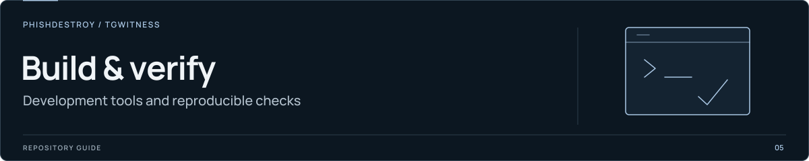

[TgWitness](../../../README.md) / [capture](../README.md)

<picture>
  <source media="(max-width: 640px)" srcset="../../../docs/assets/presentation/section-tools-mobile.svg">
  
</picture>

# Capture checks

Tests for recorder behavior, signed archives, browser controls and witness modes.
Run them from the repository root in the configured development environment.

```sh
python -m pytest addons/capture/tests -q --capture-browser
```

| Area | Tests |
| --- | --- |
| Journal, export and verification | [`test_capture.py`](test_capture.py), [`test_integration.py`](test_integration.py) |
| Browser and panel | [`test_browser.py`](test_browser.py), [`test_panel.py`](test_panel.py) |
| Video | [`test_video.py`](test_video.py) |
| Witness and beacon | [`test_witness.py`](test_witness.py), [`test_beacon.py`](test_beacon.py) |
| Official client and gateway | [`test_official.py`](test_official.py), [`test_official_proof.py`](test_official_proof.py), [`test_gateway.py`](test_gateway.py) |
| Trusted Live | [`test_trusted.py`](test_trusted.py), [`test_trusted_anchors.py`](test_trusted_anchors.py) |
| Deployment configuration | [`test_deployment.py`](test_deployment.py) |

Browser cases use a local synthetic page. Video cases use FFmpeg's synthetic
source; `CAPTURE_TEST_FFMPEG` selects the executable. These checks do not connect
a Telegram account. See [validation requirements](../README.md#validation) for
the separate live-client and container acceptance work.
