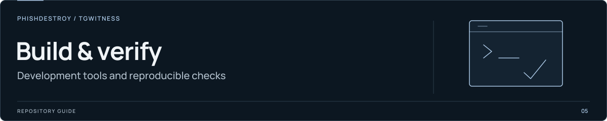

[TgWitness](../README.md) / [Documentation](README.md) / Development

# Repository guide

Start here to locate the code, understand its limits and choose the right checks.
The shared working rules live in [AGENTS.md](../AGENTS.md).
[Contributing](../.github/CONTRIBUTING.md) covers development setup and pull requests.

## Read for the task

| Task | References |
| --- | --- |
| Understand the product | [Project guide](PROJECT-GUIDE.md), [how it works](HOW-IT-WORKS.md), [current qualification](STATUS.md) |
| Install or update | [Quick start](QUICKSTART.md), [installation](INSTALLATION.md), [operations](OPERATIONS.md) |
| Change collection or history | [Collection](COLLECTION.md), [collection modes](COLLECTION-MODES.md), [history](HISTORY.md), [export limits](EXPORT-LIMITS.md) |
| Work on accounts and access | [Accounts](ACCOUNTS.md), [access model](ACCESS.md), [connection security](CONNECTION-SECURITY.md) |
| Change evidence or verification | [Evidence model](EVIDENCE.md), [verification](VERIFICATION.md), [witness](WITNESS.md), [timestamps](TIMESTAMP.md) |
| Work on Secret Chats or capture | [Pseudo-secret](PSEUDO-SECRET.md), [optional capture](OPTIONAL-CAPTURE.md), [trusted-live recorder](TRUSTED-LIVE.md), [sealed capture](SEALED-ACTIONS.md) |
| Work on Phala or Intel TDX | [High-assurance deployment](HIGH-ASSURANCE.md), [security model](SECURITY-MODEL.md), [deployment](DEPLOYMENT.md) |
| Change the interface | [Frontend](FRONTEND.md), [panel](PANEL.md), [settings](SETTINGS.md), [architecture](ARCHITECTURE.md) |
| Use or change integrations | [CLI](CLI.md), [MCP](MCP.md), [webhooks](WEBHOOKS.md), [archive-access skills](../.agents/README.md) |
| Edit README graphics or the website | [Presentation assets](assets/presentation/README.md), [website sources](../website/README.md), [publishing](internal/PUBLISHING.md) |
| Maintain CI, releases or the Wiki | [Checks and routing](internal/CI-PARALLELISM.md), [release procedure](internal/RELEASE.md), [readiness](internal/READINESS.md), [Wiki](internal/WIKI.md) |

Use these references together with the current implementation. A feature may exist
on a development branch without being included in `main`, a release or the installed
application. A demo uses fictional data; its interface alone does not qualify live
Telegram behavior. Keep implementation, revision and test evidence attached to claims.

## Code map

| Area | Starting points |
| --- | --- |
| Application entry and commands | [__main__.py](../tgwitness/__main__.py), [cli.py](../tgwitness/cli.py) |
| HTTP API and panel | [app.py](../tgwitness/app.py), [static/](../tgwitness/static/README.md) |
| Collection and storage | [collector.py](../tgwitness/collector.py), [store.py](../tgwitness/store.py) |
| Evidence and verification | [evidence.py](../tgwitness/evidence.py), [verify.py](../tgwitness/verify.py) |
| TDX, OS measurements and providers | [tdx.py](../tgwitness/tdx.py), [dstack_image.py](../tgwitness/dstack_image.py), [providers/](../tgwitness/providers/README.md) |
| Separate capture recorder | [tgwitness_capture/](../tgwitness_capture/README.md) |
| Translations | [Panel locales](../tgwitness/locales/README.md), [setup guides](../tgwitness/guide_locales/README.md), [website locales](../website/i18n/README.md) |
| Site generation and checks | [tools/](../tools/README.md), [website/](../website/README.md) |
| Deployment templates | [deploy/](../deploy/README.md) |

Follow imports and callers from these entry points. Collection, authorization and
exports span several modules; a single filename is not the entire implementation.

## Validation

Run commands from the repository root using the development environment described
in [Contributing](../.github/CONTRIBUTING.md#development-setup). The project requires
Python 3.11 or newer. Respect the operator's host restrictions: a command listed
here is not permission to run it on a machine reserved for editing source.

| Change | Relevant check |
| --- | --- |
| Python source | `python -m ruff check .` and the regression for the changed behavior |
| Public docs or packaging | `python tools/check_publication.py`; before publication, use `--git-index` to inspect staged files too |
| CLI behavior | `python -m pytest tools/test_cli.py -q` |
| Evidence boundaries | `python -m pytest tools/test_assurance_boundaries.py -q` |
| Panel behavior | `python tools/check_browser.py` and the affected browser check listed in [tools/](../tools/README.md) |
| Website | `python tools/build_site.py`, `python tools/check_site.py`, `python tools/check_docs_site.py` |
| Source archive | `python -I tools/check_source_archive.py` |

Choose checks that exercise the change. A documentation-only edit needs verified
links and claims; it does not need a connected Telegram account. Browser acceptance
uses synthetic accounts and fake transport. Tests with live options have a different
scope and require an authorized environment and task.

For an isolated site build, pass `--output PATH` to `tools/build_site.py`.
Some checks use fixed `test-results/` or `dist/` locations, so inspect their output
paths before running concurrently. `tools/run_checks.py --output PATH` changes the
runner's logs, not the output directories embedded in its child checks. A pytest
`--basetemp` directory is cleared on use; give each run a fresh path.

## Public and private material

`AGENTS.md`, `CLAUDE.md`, `GEMINI.md` and this guide are public repository content.
The source archive includes them so their links work in a downloaded checkout.
Keep computer-specific instructions and access inventories outside the repository.
They must not be copied into docs, release archives, demos or generated text editions.

Use the existing private credential store for an authorized operation. Public
instructions describe configuration and permissions without listing working access
paths, account identities, server addresses, session material or token values.
Do not treat a failed request as proof that a server is stopped or an account is
logged out; distinguish access failure from the resource's verified state.

## Review and delivery

Inspect the current diff and stage only the task's files. Check the selected source
and [publication rules](internal/PUBLISHING.md) before an authorized push or release.
Public packaging uses an explicit allowlist in [build_source.py](../tools/build_source.py);
adding a root document with local links may require adding it there as well.

Report the revision, checks actually completed and remaining limits. For a website
deployment, verify the public artifact after the deployment job finishes. A passing
build, a skipped deployment or an older successful release is insufficient evidence
that the requested revision is published.
