[TgWitness](../../../README.md) / [assets](../README.md)

<picture>
  <source media="(max-width: 640px) and (prefers-reduced-motion: reduce)" srcset="./section-assets-mobile-static.svg">
  <source media="(prefers-reduced-motion: reduce)" srcset="./section-assets-static.svg">
  <source media="(max-width: 640px)" srcset="./section-assets-mobile.svg">
  
</picture>

# Presentation assets

README, Wiki and documentation artwork. Screenshots use demo records.

| Files | Use |
| --- | --- |
| `readme-intro.svg`, `readme-intro-mobile.svg` | Compact README covers; directly editable SVG text and paths, with no animation or external fonts |
| `readme-performance-mobile.svg` | Phone layout of the 6 November 2026 measurements; the same rates and scale as the desktop chart |
| `casework-hero*`, `casework-handbook*` | Project and Wiki covers |
| `readme-nav-*` | README buttons, with shorter phone labels |
| `readme-features*`, `readme-feature-*` | Export, investigation and saved-version animations |
| `readme-workspace-*.webp` | Demo recording in both themes, plus phone crops and stills |
| `casework-chain*`, `casework-checkpoint*`, `evidence-*` | Evidence diagrams |
| `casework-assurance*` | Local, audited VM and Phala / Intel TDX deployment checks |
| `readme-services*`, `readme-card-*` | Alerts and encrypted S3 copies |
| `readme-handbook*`, `wiki-*` | Handbook routes and chapter covers |
| `identity-meta-*` | Version, languages, test and licence badges |
| `folder-*`, `readme-button-*`, `*divider*` | Folder headers, links and separators |
| `chapter-*` | Compact, static category headers for reference pages; editable SVG text and paths |
| `section-*` | Animated directory covers, narrow-screen layouts and reduced-motion stills |
| `preview-github.png`, `preview-social.png` | Sharing images |

## Rebuild

Run from the repo root. The SVG renderers need `fonttools` and local Manrope / Space
Grotesk font files. Font licences: [Manrope](OFL-Manrope.txt), [Space Grotesk](OFL-SpaceGrotesk.txt).

```sh
python website/render_casework.py --display-font /path/to/SpaceGrotesk.ttf --text-font /path/to/Manrope.ttf
python website/render_readme_navigation.py --font /path/to/Manrope.ttf
python website/render_readme_panels.py --font /path/to/Manrope.ttf
python website/render_wiki_headers.py --font /path/to/Manrope.ttf
python website/render_identity.py --font /path/to/Manrope.ttf
python website/render_directory_headers.py --font /path/to/Manrope.ttf
```

`render_identity.py` reads the version and language counts from source.
After a version change, use `--metadata-only` to refresh its badges, update the
README alt text and `docs/STATUS.md`, then run `python tools/check_publication.py`.

Directory covers use layered illustrations: reference pages, capture frames,
linked components, server racks and project artwork. The compact main cover names
the product and illustrates three observation types; the interface follows below.
The assurance diagram compares deployment choices and follows the TDX checks from
Intel's root to the journal. Headings stay fixed; motion belongs to the illustrations.
Every SVG is self-contained. Animated covers use outlined lettering.
Their `<picture>` elements select a `-static.svg`
version for `prefers-reduced-motion: reduce`. Keep those sources before the regular
mobile source: the narrow static version first, then the wide static version,
then the animated narrow version at `max-width: 640px`.

The README demo uses its dark recording in both page themes, matching the diagrams.
Its source conditions select only width and motion: GitHub's theme handling
replaces compound color-scheme conditions and can select the wrong crop or still.

To refresh the demo recording, build the site and run
`python website/capture_readme.py` with Playwright and Pillow installed.
Use `python website/render_presentation.py` for the sharing PNGs.

Check both themes and a narrow viewport before replacing images. Keep the still
variants: `<picture>` selects them for reduced motion. Keep useful alt text too.
The static `readme-intro*` and `chapter-*` covers use system fonts.

For a public GitHub revision, run the **Project website** workflow with
`review_readme` enabled. The existing capture utility records the main README and
three directory pages at desktop and phone widths in both themes. Screenshots and
selected image sources are retained in the `site-check-results` artifact.

The [diagram reference](../../SHOWCASE.md) shows the evidence illustrations.
The Wiki builder copies linked assets into its own repository.

The compact `chapter-*` headers use system fonts, contain no scripts or external
resources, and are shared by related pages. Their illustrations identify a topic;
they do not present measurements. Keep page titles and navigation as Markdown.
