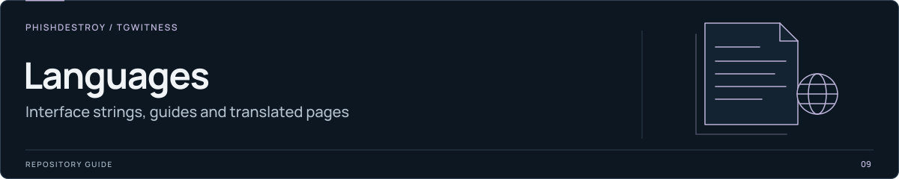

[TgWitness](../../README.md) / [Documentation](../README.md)

<picture>
  <source media="(max-width: 640px) and (prefers-reduced-motion: reduce)" srcset="../assets/presentation/section-languages-mobile-static.svg">
  <source media="(prefers-reduced-motion: reduce)" srcset="../assets/presentation/section-languages-static.svg">
  <source media="(max-width: 640px)" srcset="../assets/presentation/section-languages-mobile.svg">
  
</picture>

# 한국어

Project notices in Korean. This directory contains the translated statements;
the [English documentation index](../README.md) covers installation and use.

| Document | Contents |
| --- | --- |
| [`OPERATOR-INCOMPATIBILITY.md`](OPERATOR-INCOMPATIBILITY.md) | Operator notice |
| [`TAYLOR-WESSING-EXCLUSION.md`](TAYLOR-WESSING-EXCLUSION.md) | Project position |

For work on translations, see the [website language guide](../../website/i18n/README.md)
and the [setup-guide catalogs](../../tgwitness/guide_locales/README.md).
