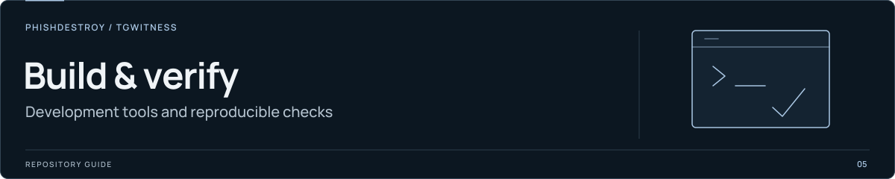

[TgWitness](../../README.md) / [tools](../README.md)

<picture>
  <source media="(max-width: 640px) and (prefers-reduced-motion: reduce)" srcset="../../docs/assets/presentation/section-tools-mobile-static.svg">
  <source media="(prefers-reduced-motion: reduce)" srcset="../../docs/assets/presentation/section-tools-static.svg">
  <source media="(max-width: 640px)" srcset="../../docs/assets/presentation/section-tools-mobile.svg">
  
</picture>

# Compatibility fixtures

Retained inputs for checking compatibility with earlier evidence formats.

| Fixture | Checked by |
| --- | --- |
| [`evidence-before-fulltext.zip`](evidence-before-fulltext.zip) | [`test_fulltext.py`](../test_fulltext.py) |

The full-text tests verify that an archive from before the search implementation
remains readable and that earlier verification code accepts a current archive.
Keep this historical fixture intact when changing the search index or exporter.

Run from the repository root in the development environment:

```sh
python -m pytest tools/test_fulltext.py -q
```

[Evidence format](../../docs/EVIDENCE.md) · [Search](../../docs/SEARCH.md)
