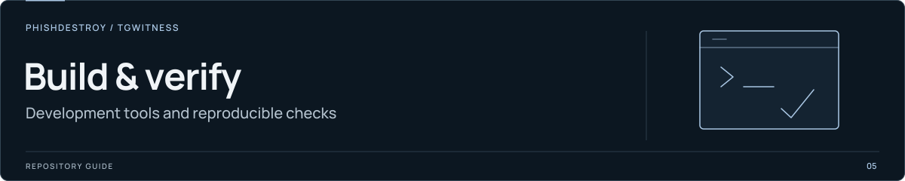

[TgWitness](../../README.md) / [tools](../README.md)

<picture>
  <source media="(max-width: 640px) and (prefers-reduced-motion: reduce)" srcset="../../docs/assets/presentation/section-tools-mobile-static.svg">
  <source media="(prefers-reduced-motion: reduce)" srcset="../../docs/assets/presentation/section-tools-static.svg">
  <source media="(max-width: 640px)" srcset="../../docs/assets/presentation/section-tools-mobile.svg">
  
</picture>

# Timestamp test vectors

Recorded RFC 3161 requests and replies used by the attestation-report checks.

[`time-stamps.json`](time-stamps.json) contains replies from the Belgian government
TSA and FreeTSA for the synthetic report embedded in that same file, dated
4 November 2026. The tests consume these recorded bytes.

See [`check_attestation_report.py`](../check_attestation_report.py) for signature,
timestamp and changed-report cases. For actual timestamp acquisition, use the
[timestamp procedure](../../docs/TIMESTAMP.md).
