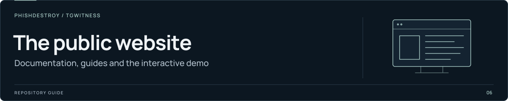

[TgWitness](../../README.md) / [website](../README.md)

<picture>
  <source media="(max-width: 640px) and (prefers-reduced-motion: reduce)" srcset="../../docs/assets/presentation/section-website-mobile-static.svg">
  <source media="(prefers-reduced-motion: reduce)" srcset="../../docs/assets/presentation/section-website-static.svg">
  <source media="(max-width: 640px)" srcset="../../docs/assets/presentation/section-website-mobile.svg">
  
</picture>

# Interactive demo

The public demo uses fictional records and a browser API mock. It lets visitors
explore the workspace without signing in to Telegram.

| Content | Purpose |
| --- | --- |
| [`mock.js`](mock.js) | Browser-side API responses and simulated actions |
| [`fixtures.json`](fixtures.json) | Recorded synthetic workspace data |
| [downloads/](downloads/README.md) | Example exports and verification files |
| [report/](report/README.md) | Example report and sharing copy |

## Build and preview

Run from the repository root:

```sh
python tools/build_site.py
```

Follow the [local preview instructions](../../docs/internal/PUBLISHING.md#preview-the-website-locally)
and open the generated demo. The builder combines these files with the application
interface; this directory is not a standalone copy of that interface.

Use [`capture_demo.py`](../../tools/capture_demo.py) when refreshing the synthetic
fixtures. Keep mock behavior aligned with the [panel guide](../../docs/PANEL.md).
